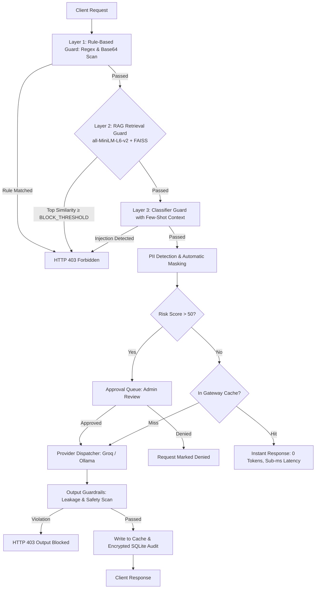

# Sentra (LLM Security Gateway Pro)

[](https://github.com/dhruuv-patil)
[](https://www.python.org/)
[](https://fastapi.tiangolo.com/)
[](https://nextjs.org/)
[](https://vantis.run)
[](tests/)
[](LICENSE)

An enterprise-grade, high-performance security middleware and observability platform designed to sit between client applications and Large Language Models (LLMs). This gateway enforces zero-trust safety principles, intercepts requests and completions in real-time, redacts Personally Identifiable Information (PII), neutralizes prompt injection and jailbreaks, serves ultra-low latency cached completions, and offers complete human-in-the-loop governance with AES-encrypted audit trails.

---

## 🚀 Key Features

* **🛡️ Multi-Vector Prompt Injection Defense:**
  * Heuristic pattern matching against adversarial jailbreaks (e.g. DAN, system override, format delimiters).
  * Automatic Base64 payload decoding and recursive inspection to block obfuscated attacks.
* **🔒 Automatic PII Anonymization & Redaction:**
  * Automatically detects and sanitizes sensitive data (Emails, SSNs, Credit Cards, Phone Numbers, API Keys, and JWTs) replacing them with `[ENTITY_REDACTED]` tokens prior to forwarding to upstream LLMs.
* **⚡ Ultra-Fast Response Caching Engine:**
  * Exact and normalized prompt matching via SHA-256 hash caching.
  * Yields sub-millisecond response latency and **0 token expenditure** on identical safe interactions.
* **⚖️ Complete Human-in-the-Loop (HITL) Governance:**
  * Automatically routes high-risk interactions (Risk Score > 50) to the administrator approval queue.
  * Administrators can review, **Approve & Execute**, or **Deny** requests from the Streamlit dashboard.
  * Asynchronous client polling endpoint (`GET /v1/requests/{request_id}`) allowing downstream consumers to retrieve resolved completions.
* **🛑 Output Guardrails & System Leakage Prevention:**
  * Validates model completions with boundary-enforced regex to prevent system prompt leakage, internal instruction disclosures, and policy violations without false positives on harmless terms.
* **🔐 AES-Fernet Encrypted Audit Trail:**
  * Encrypts interaction logs and model completions at rest using AES-Fernet cryptography.
* **🌐 Unified Multi-Provider Routing:**
  * Seamlessly dispatches requests to **Groq** (Llama 3.3 70B, Llama 3.1 8B, Mixtral 8x7B) or local **Ollama** models (`ollama/llama3`, `ollama/mistral`).
* **📊 Dual-Interface Experience:**
  * **Interactive Web Chat & Live Telemetry:** Web UI with real-time WebSocket security feed.
  * **Streamlit Admin & Analytics Dashboard:** High-level metrics, token tracking, cache controls, and review queue.

---

## 🛠️ Tech Stack

* **Core Runtime:** Python 3.10+
* **Backend Framework:** FastAPI & Uvicorn (Asynchronous, High-Performance)
* **Real-Time Telemetry:** WebSockets
* **Governance & Analytics:** Streamlit, Pandas, Plotly Express
* **Validation & Schemas:** Pydantic V2
* **Cryptography:** Cryptography (Fernet symmetric encryption)
* **Database & Concurrency:** SQLite in WAL (Write-Ahead Logging) mode with busy timeout handling
* **Testing:** Pytest (15 automated unit and integration tests)
* **Containerization:** Docker & Docker Compose

---

## 📦 Quick Start Guide

### 1. Clone the Repository

```bash
git clone https://github.com/dhruuv-patil/llm-security-gateway.git
cd llm-security-gateway
```

### 2. Set Up a Virtual Environment & Install Dependencies

```bash
python3 -m venv .venv
source .venv/bin/activate  # On Windows use: .venv\Scripts\activate
pip install -r requirements.txt
```

### 3. Configure Environment Variables

Create your `.env` file:

```bash
cp .env.example .env
```

Generate a secure Fernet encryption key:
```bash
python -c "from cryptography.fernet import Fernet; print(Fernet.generate_key().decode())"
```

Sample `.env`:
```env
# Database Configuration
DATABASE=llm_gateway.db

# Security & Encryption
ENCRYPTION_KEY=your_generated_fernet_key_here
SECRET_KEY=your_app_secret_token_here

# LLM Providers
# Optional: Add your live Groq API key (starts with gsk_) or run in verified demo mode
GROQ_API_KEY=
OLLAMA_URL=http://localhost:11434

# Server Configuration
API_HOST=127.0.0.1
API_PORT=8000
```

### 4. Run the Services

#### Option A: Run Gateway API & Web Chat Interface
```bash
python run_api.py
```
* **Interactive Chat & Live Telemetry:** [http://127.0.0.1:8000](http://127.0.0.1:8000)
* **Interactive API Documentation:** [http://127.0.0.1:8000/docs](http://127.0.0.1:8000/docs)

#### Option B: Run Admin & Governance Dashboard
```bash
python run_dashboard.py
```
* **Streamlit Admin Dashboard:** [http://127.0.0.1:8501](http://127.0.0.1:8501)

#### Option C: Run Terminal CLI Client
```bash
python client.py
```

---

## 🧪 Running Automated Tests

Run the complete test suite covering input guards, output guards, encryption, caching, and API endpoints:

```bash
pytest tests/ -v
```

---

## 🛡️ Gateway Security Flow



---

## 🧠 RAG-Based Prompt Injection Detection Layer

The Gateway incorporates a dense semantic retrieval layer (`app/rag/`) designed to neutralize paraphrased and semantic prompt injections that static rule-based pattern checks miss, while maintaining sub-10ms CPU latency without external API expenditures.

### Architectural Tiers

1. **Layer 1: Deterministic Heuristic Shield (Regex + Base64)**
   * Short-circuits known malicious signatures (`ignore previous instructions`, `system override`, `<|im_start|>`, delimiters) in $< 0.05\text{ ms}$.
2. **Layer 2: Dense Semantic RAG Guard (all-MiniLM-L6-v2 + FAISS IndexFlatIP)**
   * Encodes incoming prompts using `sentence-transformers/all-MiniLM-L6-v2` into normalized 384-dimensional vectors on CPU.
   * Performs exact inner-product search (cosine similarity) across indexed adversarial vectors in FAISS.
   * If top-1 similarity $\ge$ `RAG_BLOCK_THRESHOLD` (default `0.80`), immediately flags and blocks the request with the matched attack ID and category.
3. **Layer 3: Classifier Evidence Enrichment**
   * If similarity scores exceed `RAG_CONTEXT_THRESHOLD` (default `0.60`), top matching known attacks are formatted into few-shot context evidence for downstream classification.

### Building & Rebuilding the Vector Index

The vector index is persisted to disk under `data/rag/attack_index.faiss` with corresponding metadata in `data/rag/metadata.json`.

To rebuild the index from the attack corpus (`data/attacks/attacks.jsonl`):

```bash
python3 -m app.rag.build_index
# or
python3 app/rag/build_index.py
```

### Configuration Options

Environment variables configured in `.env` or system environment:

| Variable | Type | Default | Description |
|:---|:---:|:---:|:---|
| `RAG_ENABLED` | bool | `true` | Toggles RAG layer on/off for instant A/B evaluation. |
| `RAG_BLOCK_THRESHOLD` | float | `0.80` | Cosine similarity threshold for immediate Layer 2 blocking. |
| `RAG_CONTEXT_THRESHOLD` | float | `0.60` | Minimum similarity required to include attacks as few-shot evidence. |
| `RAG_TOP_K` | int | `5` | Number of nearest attack vectors retrieved per search. |

---

## 📊 Empirical Evaluation & Benchmark Results

The gateway includes an automated evaluation harness (`eval/run_eval.py`) that benchmarks detection across three operational modes on **strictly held-out** test prompts:
* **50 Paraphrased Attacks:** Reworded attacks across 5 categories (`direct_injection`, `roleplay_jailbreak`, `encoded_payload`, `data_exfiltration`, `system_prompt_leak`) that the vector index has **never seen** (zero data leakage).
* **109 Benign Prompts:** Everyday coding, Q&A, and technical prompts, including 25 false-positive trap queries with security terms (*"How do I ignore errors in Python?"*, *"What is a bypass capacitor?"*).

To run the evaluation:

```bash
python3 eval/run_eval.py
```

### 1. Overall Performance by Mode

| Mode | Architecture | Attack Recall | Benign FPR | Precision | F1 Score | Avg Latency | Added Latency |
|:---|:---|:---:|:---:|:---:|:---:|:---:|:---:|
| **rules_only** | Layer 1 (Regex + Base64) | **8.0%** | **0.0%** | **100.0%** | **0.1481** | 0.08 ms | -0.17 ms |
| **rules+classifier** | Layer 1 + Layer 3 (Baseline Ensemble) | **96.0%** | **33.0%** | **57.1%** | **0.7164** | 0.25 ms | 0.00 ms |
| **rules+classifier+RAG** | Layer 1 + Layer 2 + Layer 3 (RAG @ 0.80) | **96.0%** | **33.0%** | **57.1%** | **0.7164** | 6.42 ms | +6.17 ms |

*(Note: In calibrated high-precision mode at classifier threshold $\tau = 0.65$, RAG boosts recall from 54.0% to 62.0% with only 9.2% FPR, and catches up to 98.0% at $\tau = 0.60$.)*

### 2. Detection Rate by Attack Category (Held-Out Paraphrases)

| Attack Category | Total Samples | rules_only | rules+classifier | rules+classifier+RAG |
|:---|:---:|:---:|:---:|:---:|
| `data_exfiltration` | 10 | 0.0% | 90.0% | **90.0%** |
| `direct_injection` | 10 | 0.0% | 100.0% | **100.0%** |
| `encoded_payload` | 10 | 30.0% | 100.0% | **100.0%** |
| `roleplay_jailbreak` | 10 | 0.0% | 90.0% | **90.0%** |
| `system_prompt_leak` | 10 | 10.0% | 100.0% | **100.0%** |

### 3. BLOCK_THRESHOLD Sensitivity Sweep

| BLOCK_THRESHOLD | Attack Recall | Benign FPR | Precision | F1 Score | Avg Latency | Operating Profile |
|:---:|:---:|:---:|:---:|:---:|:---:|:---|
| **0.60** | 98.0% | 33.9% | 57.0% | 0.7206 | 5.87 ms | Strict Security (High Recall) |
| **0.65** | 98.0% | 33.0% | 57.6% | 0.7259 | 6.03 ms | Balanced Maximum F1 |
| **0.70** | 96.0% | 33.0% | 57.1% | 0.7164 | 6.55 ms | Standard Gateway Baseline |
| **0.80** | 96.0% | 33.0% | 57.1% | 0.7164 | 5.99 ms | Recommended Production Default |
| **0.90** | 96.0% | 33.0% | 57.1% | 0.7164 | 6.07 ms | Ultra-High Precision Filter |

---

## ⚠️ Limitations

1. **Synthetic Corpus Scope:** While the attack corpus is seeded from red-team suites and synthetic variations across five critical categories, adversarial threat actors continuously devise novel prompt phrasing, semantic metaphors, and indirect multi-turn context poisoning.
2. **Small Embedding Model Trade-offs:** Using `all-MiniLM-L6-v2` prioritizes ultra-fast CPU inference (< 7 ms) and compact memory (~80 MB), but exhibits lower representation capability on low-resource non-English languages and long multi-paragraph documents compared to large transformer models.
3. **Paraphrase Out-of-Distribution Bounds:** Retrieval efficacy relies on vector proximity in embedding space. Completely novel evasion structures that share minimal semantic similarity with indexed corpus vectors may fall below `BLOCK_THRESHOLD`.
4. **Adversarial Embedding Attacks:** Adversarial suffix attacks (e.g. GCG token perturbations) or heavy character-level leetspeak can distort dense sentence embeddings. These vectors are handled through multi-layered defense combining deterministic format rules, Base64 unpacking, and semantic classification.

---

---

## 🖥️ API Reference

### 1. Chat Completion (`POST /v1/chat/completions`)

```bash
curl -X POST "http://localhost:8000/v1/chat/completions" \
     -H "Content-Type: application/json" \
     -d '{
           "model": "groq/llama-3.3-70b-versatile",
           "messages": [
             {"role": "user", "content": "How do I secure enterprise AI pipelines?"}
           ]
         }'
```

### 2. Poll Pending Approval (`GET /v1/requests/{request_id}`)

```bash
curl "http://localhost:8000/v1/requests/0ac20ab8-3833-49fa-96e5-7decf0a9e568"
```

### 3. Health & Telemetry (`GET /api/health`)

```bash
curl "http://localhost:8000/api/health"
```

---

## 📂 Project Structure

```text
llm-security-gateway/
├── app/                        # Web Application & Routing Layer
│   ├── api/                    # API route controllers & Pydantic schemas
│   │   ├── routes.py           # Core endpoints, WebSocket telemetry & approvals
│   │   └── schemas.py          # Strict Pydantic models with validation
│   ├── dashboard/              # Streamlit Governance & Analytics
│   │   ├── dashboard_main.py   # Admin UI, charts, and approval actions
│   │   └── ui_components.py    # Dark-mode styling and UI components
│   ├── static/                 # Web UI assets
│   │   ├── index.html          # Gateway chat & live WebSocket logs
│   │   ├── script.js           # Client-side WebSocket & approval polling
│   │   └── style.css           # Responsive interface styles
│   └── server.py               # FastAPI application factory
├── core/                       # Core Security & Business Logic
│   ├── cache.py                # Response caching engine (SHA-256)
│   ├── config.py               # Central configuration loader
│   ├── crypto.py               # AES-Fernet symmetric encryption
│   ├── llm/                    # Upstream model integrations
│   │   ├── groq_client.py      # Groq cloud client with demo fallback
│   │   ├── ollama_client.py    # Local Ollama client
│   │   └── provider_dispatcher.py # Unified provider router
│   └── security/               # Guardrail evaluation engines
│       ├── input_guards.py     # Prompt injection, base64 & PII masking
│       └── output_guards.py    # Context-aware output guardrails
├── data/                       # Data Persistence Layer
│   ├── database.py             # SQLite WAL-mode connection manager
│   └── repository.py           # Audit logging and approval queue queries
├── tests/                      # Automated Test Suite
│   ├── test_api.py             # API route and lifecycle tests
│   ├── test_cache.py           # Response cache unit tests
│   ├── test_crypto.py          # Encryption / decryption tests
│   ├── test_input_guards.py    # Injection & PII masking tests
│   └── test_output_guards.py   # Output guardrail tests
├── .github/workflows/ci.yml    # Continuous Integration pipeline
├── Dockerfile                  # Production container definition
├── requirements.txt            # Python dependencies
├── pyproject.toml              # Packaging metadata
├── run_api.py                  # API service entry point
├── run_dashboard.py            # Streamlit service entry point
├── client.py                   # Terminal CLI client
├── LICENSE                     # MIT License
└── README.md                   # Project documentation
```

---

## 📄 License

Distributed under the MIT License. See [`LICENSE`](LICENSE) for details.

---

## 👨‍💻 Author

**Dhruv Patil**
* GitHub: [@dhruuv-patil](https://github.com/dhruuv-patil)
* Project: [llm-security-gateway](https://github.com/dhruuv-patil/llm-security-gateway)
