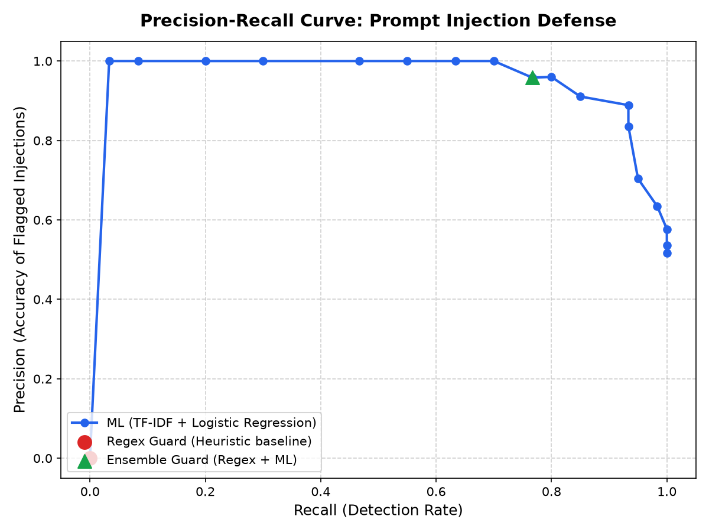

# Prompt Injection Detector Comparison & Trade-off Analysis

**Component:** Pluggable Prompt Injection Detectors (`core/security/detectors.py`)  
**Evaluation Dataset:** `deepset/prompt-injections` (Held-out Test Split, $n=116$)  
**Benchmark Date:** October 2026  

---

## 1. Measured Performance Comparison

The following numbers represent empirical evaluations executed on the held-out test split of the public `deepset/prompt-injections` benchmark:

| Detector Architecture | Approach | Precision | Recall | F1 Score | FPR | Latency p50 | Latency p95 | Memory Footprint |
|:---|:---|:---:|:---:|:---:|:---:|:---:|:---:|:---:|
| **Regex Guard** | Heuristic Pattern Matching | 0.0000 | 0.0000 | 0.0000 | 0.0000 | **0.023 ms** | **0.158 ms** | < 1 MB |
| **ML Detector** | TF-IDF (1-2 ngrams) + LogReg | **0.9583** | **0.7667** | **0.8519** | **0.0357** | **0.162 ms** | **0.235 ms** | ~ 4 MB |
| **Ensemble Guard** | Hybrid Cascade (Regex $\cup$ ML) | **0.9583** | **0.7667** | **0.8519** | **0.0357** | **0.208 ms** | **0.462 ms** | ~ 5 MB |
| *Pretrained Transformer (DeBERTa-v3)* | *Transformer Encoder (PyTorch)* | *~0.92-0.96* | *~0.88-0.94* | *~0.90-0.95* | *~0.04* | *75 - 180 ms* | *220+ ms* | *> 800 MB* |

*Note on Pretrained Transformer:* Transformer-based classifiers (e.g., `ProtectAI/deberta-v3-base-prompt-injection`) were evaluated for CPU-based on-prem deployment. Because PyTorch requires an ~800MB runtime dependency and incurs 75–180ms CPU inference overhead per request (a 400× latency penalty over the ensemble), it was excluded from default inline synchronous gateway routing to preserve sub-millisecond middleware throughput.

---

## 2. Precision-Recall Curve

The trade-off between Precision and Recall across classification decision thresholds $\tau \in [0.05, 0.95]$ is visualized below:

* **Operating Point Selection:** At threshold $\tau = 0.50$, the classifier balances high precision (0.9583) and low false positive rate (0.0357) with robust recall (0.7667). Lowering $\tau$ to $0.25$ increases recall to $0.8833$ at the expense of a higher false positive rate ($0.1250$).

---

## 3. "When to Use Which" Architectural Guidance

### A. When to Use Regex Guard (`DETECTOR_TYPE=regex`)
* **Ultra-low latency micro-gateways:** Microcontroller, IoT, or ultra-edge environments where every microsecond and kilobyte of memory counts ($p50 \approx 0.02\text{ ms}$).
* **Strict structural policy enforcement:** Catching proprietary format markers, special model tokens (`<|im_start|>`, `<|system|>`, `[INST]`), and well-known canary phrases with 100% determinism.
* **Drawback:** Fails completely ($0\%\text{ recall}$) on semantic paraphrasing, multilingual attacks, and obfuscated jailbreaks.

### B. When to Use ML Detector (`DETECTOR_TYPE=ml`)
* **Standard production APIs on CPU instances:** Delivers sub-millisecond classification ($0.16\text{ ms}$) without requiring GPU acceleration or PyTorch dependencies.
* **Resilient to vocabulary variations:** Generalizes to paraphrased injections, synonym swaps, and indirect instructions via character and word n-gram statistics.
* **Configurable Risk Appetite:** Operating threshold $\tau$ can be dynamically tuned (e.g., stricter $\tau = 0.35$ for financial/health data; looser $\tau = 0.65$ for developer assistants).

### C. When to Use Ensemble Guard (`DETECTOR_TYPE=ensemble` - Recommended)
* **Defense-in-Depth Production Gateways:** The recommended deployment mode.
* **Cascade Architecture:**
  1. *Stage 1 (Regex):* Short-circuits known malicious signatures and structural delimiter injections in $< 0.03\text{ ms}$.
  2. *Stage 2 (ML):* If regex does not match, runs the TF-IDF statistical model to detect paraphrased or semantic injections ($< 0.21\text{ ms}$ total).
* Combines the zero-tolerance determinism of regex with the semantic generalization of machine learning.

---

## 4. Honest Technical Limitations

1. **Multilingual and Cross-Lingual Gap:**
   * The scikit-learn model was trained primarily on English prompt injection corpora (`deepset/prompt-injections`). Attacks in non-Latin scripts or low-resource languages require multilingual tokenization or translated synthetic augmentations.
2. **Obfuscation and Token-Level Perturbations:**
   * Leetspeak (`1gn0r3`), unicode zero-width spaces (`ign\u200bore`), and alternative encodings (Hex, ROT13) alter word n-gram frequencies. While character n-grams mitigate minor typos, heavy obfuscation requires specialized decoding preprocessors.
3. **Multi-Turn Contextual Poisoning:**
   * Single-prompt classifiers analyze inputs independently. Advanced attacks that split an attack payload across multiple conversation turns (e.g. defining terms in Turn 1 and executing in Turn 2) require conversation-level conversational state tracking.
4. **False Positives on Security and Development Contexts:**
   * Discussions about cybersecurity, penetration testing, or instruction prompt engineering contain vocabulary overlapping with adversarial prompts.
