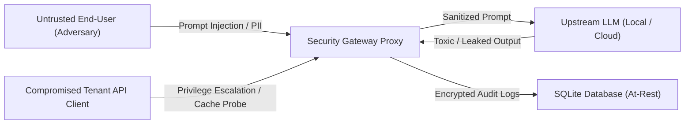

# LLM Security Gateway: Threat Model & Security Architecture

**Document Version:** 1.0  
**Scope:** `llm-security-gateway` (FastAPI Middleware, In-Memory Caching, Local SQLite Persistence, ML Guardrails)  
**Target Deployment:** Sovereign On-Premise, Air-Gapped Enclaves, and Cloud-Edge Hybrid Environments  

---

## 1. System Overview

The `llm-security-gateway` operates as an inline, zero-trust security proxy deployed between client applications (microservices, internal developer tools, public APIs) and Large Language Model inference backends (local Ollama instances or Groq Cloud LPUs).

Its primary objective is to inspect, sanitize, govern, and log all prompt interactions while preserving strict multi-tenant boundaries and data sovereignty in air-gapped or on-prem environments.

---

## 2. Assets to Protect

| Asset | Classification | Description & Impact if Compromised |
|:---|:---:|:---|
| **Personally Identifiable Information (PII)** | **High / Restricted** | End-user emails, SSNs, credit card numbers, phone numbers, API keys, and JWTs. Leakage violates GDPR/HIPAA/PCI-DSS. |
| **System Prompts & Rules** | **Confidential** | Proprietary corporate instructions, safety guidelines, and role constraints embedded in system messages. |
| **Audit Logs & Historical Traffic** | **Confidential** | Decrypted user prompts and LLM completions stored at rest in SQLite. |
| **Multi-Tenant Cache Entries** | **Confidential** | Cached completions stored in `cache_entries`. Unauthorized access allows cross-tenant information exfiltration. |
| **Service Availability & LLM Quotas** | **Operational** | Upstream API credits, GPU/CPU inference capacity, and gateway throughput. Vulnerable to resource exhaustion and DoS. |

---

## 3. Threat Actors & Adversarial Capabilities



1. **Untrusted End-User (External Adversary):**
   * *Capability:* Can submit arbitrary, multi-turn, obfuscated, or adversarial prompt payloads.
   * *Motivation:* Circumvent model guardrails (jailbreaks), extract system instructions, exfiltrate data, or abuse compute.
2. **Compromised / Malicious Tenant:**
   * *Capability:* Possesses valid API credentials with restricted permissions.
   * *Motivation:* Attempt cross-tenant cache snooping, access unauthorized high-tier models, or bypass administrative review queues.
3. **Compromised / Rogue Upstream LLM:**
   * *Capability:* Can generate hallucinated, toxic, policy-violating, or system-prompt-leaking completion text.
   * *Motivation:* Accidental leakage or alignment degradation under complex adversarial pressure.
4. **Network Eavesdropper:**
   * *Capability:* Intercepts network packets between client, gateway, and upstream.

---

## 4. Trust Boundaries & Architecture

```
[ UNTRUSTED CLIENT DOMAIN ]
          │  HTTPS / Bearer API Key (Constant-Time HMAC)
          ▼
┌─────────────────────────────────────────────────────────────┐
│ TRUST BOUNDARY 1: Ingress Authentication & Rate Limiter     │
├─────────────────────────────────────────────────────────────┤
│ 1. Client Identity & Tenant Scoping (api_tokens)            │
│ 2. Sliding Window Rate Limiting (60 RPM / Tenant)           │
│ 3. Request Payload Size Validation (<= 128 KB)              │
│ 4. Tenant Model Authorization Whitelist                     │
└─────────────────────────────────────────────────────────────┘
          │
          ▼
┌─────────────────────────────────────────────────────────────┐
│ TRUST BOUNDARY 2: Input Guardrails & Sanitization           │
├─────────────────────────────────────────────────────────────┤
│ 1. Multi-Turn Injection Defense (Regex + TF-IDF Classifier) │
│ 2. PII Detection & Luhn-Verified Credit Card Masking        │
│ 3. Adversarial Risk Scoring & HITL Governance Gate          │
└─────────────────────────────────────────────────────────────┘
          │
          ▼
┌─────────────────────────────────────────────────────────────┐
│ TRUST BOUNDARY 3: Multi-Tenant Response Cache               │
├─────────────────────────────────────────────────────────────┤
│ Key: SHA256(tenant_id : model : params : prompt_hash)       │
│ Strict tenant isolation prevents cross-tenant cache hits    │
└─────────────────────────────────────────────────────────────┘
          │
          ▼
┌─────────────────────────────────────────────────────────────┐
│ TRUST BOUNDARY 4: Provider Dispatcher & Air-Gap Enforcement │
├─────────────────────────────────────────────────────────────┤
│ 1. Air-Gapped Mode: Prohibits external cloud egress (Groq)   │
│ 2. Sovereign Local Egress: Local Ollama on private socket   │
│ 3. Upstream Timeout Enforcement (15s hard ceiling)         │
└─────────────────────────────────────────────────────────────┘
          │
          ▼
┌─────────────────────────────────────────────────────────────┐
│ TRUST BOUNDARY 5: Output Guardrails & Audit Persistence     │
├─────────────────────────────────────────────────────────────┤
│ 1. Output Toxicity & System Leakage Heuristic Scan          │
│ 2. AES-256 Fernet Response Encryption at Rest               │
│ 3. Zero Plaintext PII Storage in SQLite Audit Logs          │
└─────────────────────────────────────────────────────────────┘
```

---

## 5. What IS Defended

* **Multi-Turn & System Prompt Injections:** Evaluates every message in the conversation history, combining deterministic regex shortcuts with a statistical TF-IDF ML classifier ($0.85\text{ F1}$ on public test data).
* **Plaintext PII Storage:** User prompts are masked before insertion into `request_logs`, `harmful_logs`, and `approval_queue`. Neither SSNs, emails, credit cards, nor API keys are stored in plaintext in the database.
* **Multi-Tenant Cache Snooping:** Cache keys are cryptographically scoped by `tenant_id`, `model`, normalized hyperparameters (`temperature`, `max_tokens`), and SHA-256 prompt hash. One tenant can never receive another tenant's cached interaction.
* **Unauthorized Model & Cloud Egress:** In air-gapped mode (`AIRGAPPED_MODE=true`), cloud providers are rejected at the proxy layer with HTTP 403. Tenant-level token whitelists restrict individual clients to designated models.
* **Denial-of-Service via Upstream Stalls:** Hard 15-second upstream timeouts prevent worker thread pool exhaustion when upstream models hang.
* **Timing Attacks on API Keys:** All token and administrative secret comparisons utilize constant-time `hmac.compare_digest`.
* **Output Leakage & Defensive Refusals:** Detects system prompt dumps and confidentiality disclosures while permitting legitimate AI safety refusals.

---

## 6. What IS NOT Defended (Residual Risks & Explicit Non-Goals)

1. **Host-Level Compromise (Physical / Root OS Access):**
   * If an attacker obtains root access to the server filesystem, they can read `.env` (`ENCRYPTION_KEY`, `SECRET_KEY`) and decrypt the SQLite database. Defense-in-depth requires host disk encryption (LUKS/FileVault) and external secret management (Vault/AWS KMS).
2. **Advanced Multilingual Obfuscation & Novel Steganography:**
   * The ML classifier is trained predominantly on English corpora. Injections phrased in low-resource languages or encrypted via novel multi-step ciphers may bypass input filters.
3. **Indirect Prompt Injections in RAG Context:**
   * The gateway sanitizes inputs submitted by clients. If a client application fetches third-party untrusted web documents and appends them to prompt context without gateway inspection, indirect injections in the retrieved documents may compromise the model.
4. **Side-Channel Hardware Attacks:**
   * Microarchitectural cache timing (Spectre/Meltdown) or power analysis on local CPU/GPU hardware during inference is outside the scope of software middleware.
